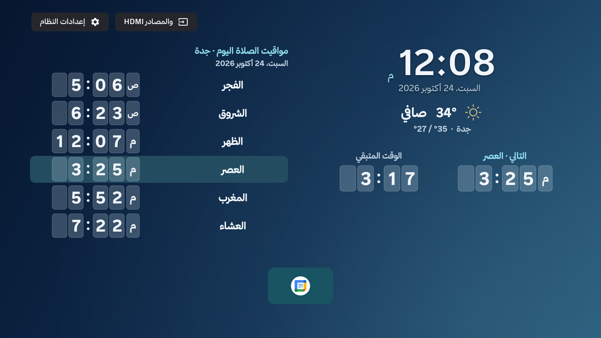
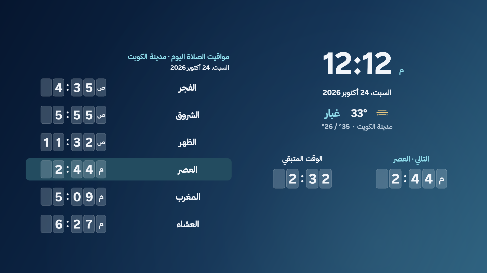

<h1 align="center">KLightTV</h1>

واجهة خفيفة وسريعة لتلفزيونك، بروح الكويت.

<a href="https://github.com/linkq8/KLightTV/releases">تنزيل التطبيق</a> · <a href="docs/INSTALL.md">طريقة التثبيت</a>

## المميزات

- [إعداد سريع من صفحتين](docs/QUICK-SETUP.md): النمط، ثم الدولة والمدينة، ثم المراجعة. مدينة واحدة للصلاة والطقس، والتفاصيل في خيارات متقدمة.
- الوضع البسيط بأرقام إنجليزية يعرض الساعة والصلاة فقط، دون طقس أو نتائج مباريات؛ نمط الصور بأرقام عربية يحتفظ بباقي المحتوى المختار.
- واجهة رئيسية وشاشة توقف خفيفتان، بعرض Android أصلي وخلفيات محلية.
- الساعة والتاريخ ومواقيت الصلاة والصلاة القادمة والعد التنازلي، بخط واضح من بعيد. ينتقل الجدول إلى الغد بعد العشاء بنصف ساعة، مع اليوم والتاريخ.
- اختيار منطقة الصلاة، ومنها الخيران والعبدلي والوفرة؛ فروق منشورة أو حساب يومي موسوم، وتصحيح مستقل من −30 إلى +30 دقيقة لكل وقت وموقع وطريقة. [مصادر المناطق](docs/REGIONS.md).
- خيارات قراءة لكبار السن: أحجام أكبر وخط أثقل وتباين وتعتيم وأرقام عربية أو إنجليزية وساعة ١٢/٢٤.
- وضع تلقائي يختار الأداء العادي أو الخفيف بحسب ذاكرة الجهاز، مع اختيار يدوي.
- اختيار الدولة والمدينة للصلاة والطقس، مع أم القرى تلقائيًا للسعودية وخيار الطريقة اليدوية. [الاستخدام وإصلاح الترقية](docs/PRAYER-LOCATION-FIX.md).
- خلفيات الكويت بدقة **4K**؛ خلفية الغروب محسّنة ومرفوعة الدقة بالذكاء الاصطناعي.
- وصول سريع لتطبيقات البث المثبتة، مع ترتيب المفضلة وإظهار التطبيقات وإخفائها.
- دون إعلانات أو أدوات تحليلات داخل KLightTV.

## التثبيت على Android TV

1. افتح **الإعدادات ← النظام/تفضيلات الجهاز ← حول**، واضغط **رقم الإصدار / Android TV OS Build سبع مرات** لتفعيل **Developer Mode**.
2. افتح **خيارات المطوّر** وفعّل **Debugging**، وتصحيح الشبكة أو **Wireless Debugging** إن توفر.
3. وصّل التلفزيون والكمبيوتر **بالشبكة نفسها**، ثم سجّل **عنوان IP والمنفذ** من إعدادات الشبكة/التصحيح.
4. افتح هذا المشروع في **Codex أو Claude Code** وأعطه عنوان التلفزيون لتثبيت KLightTV وتفعيله. وافق على رسالة السماح بالتصحيح التي تظهر على التلفزيون.

**قبل أي تعديل:** يلزم فحص حديث للموديل والنظام وبحث موثق وخطة تراجع؛ لا تعمل قوائم الحذف القديمة. [سياسة التعديل وخطوات المراجعة](docs/DEVICE-SAFETY.md).

أداة التثبيت المختصرة: `python3 tools/install.py --connect TV_IP:PORT`؛ تدعم الاقتران وخيارات إعداد Home وشاشة التوقف. [الخطوات](docs/INSTALL.md).

مثال توضيحي لعنوان IP: `192.0.2.50`؛ استبدله بعنوان تلفزيونك الفعلي. قد يلزم رمز اقتران مع Wireless Debugging.

يدعم **Android TV وGoogle TV بنظام Android 8+**. تختلف خيارات التصحيح وتعيين الواجهة حسب الجهاز.

اللقطات الجديدة من محاكي Android API34 أفقي بدقة 1920×1080، وليست من تلفاز مستخدم. تطبيقات البث غير مثبتة في بيئة الاختبار الجديدة. [صور المدن الأربع وتقرير التحقق](docs/PRAYER-LOCATION-FIX.md).
