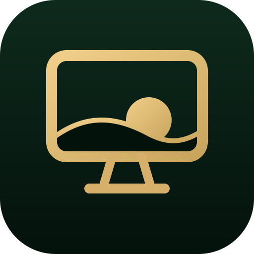
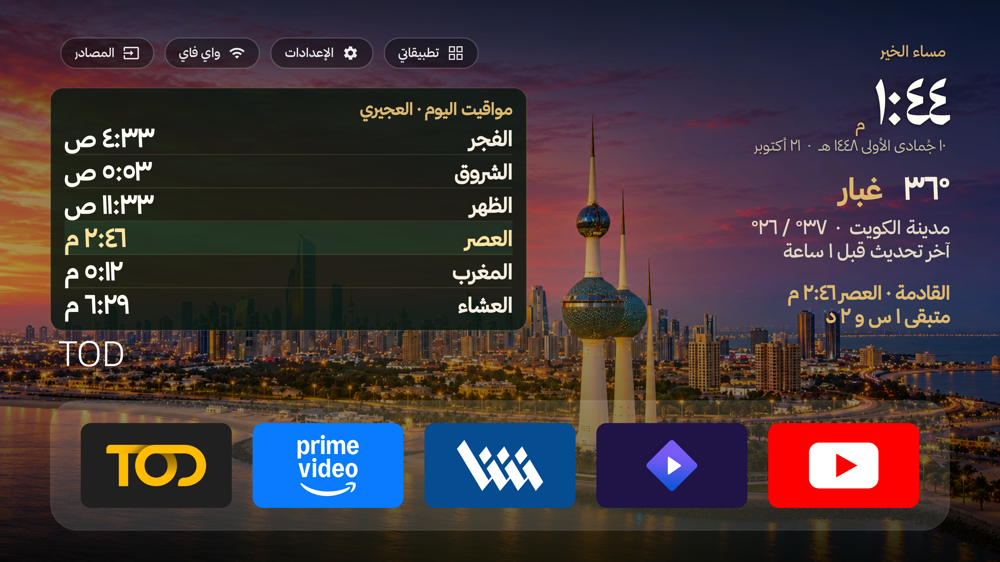
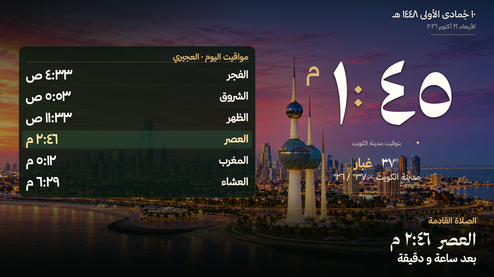

<p align="center"></p>
<h1 align="center">KLightTV</h1>
<p align="center">واجهة عربية هادئة للكويت، على تلفزيونك.</p>
<p align="center"><a href="https://github.com/linkq8/KLightTV/releases">تنزيل التطبيقات</a> · <a href="docs/INSTALL.md">دليل التثبيت</a> · <a href="docs/ARCHITECTURE.md">كيف يعمل</a> · <a href="docs/README.en.md">English</a></p>

الساعة والصلاة والطقس وخلفيات الكويت، مع وصول مباشر إلى تطبيقات البث التي تستخدمها. واجهة رئيسية وشاشة توقف بعرض Android أصلي، وخلفيات محلية؛ دون فيديو خلفية أو أخبار أو رياضة أو أسواق أو توصيات إعلانية داخل الواجهة.



## الرئيسية وشاشة التوقف

- ساعة وتاريخ ميلادي وهجري، مواقيت اليوم، الصلاة القادمة والعد التنازلي بخط واضح من بعيد.
- حالة الطقس أسفل الساعة، مع توقعات الطقس وقراءة الغبار عند توفرها.
- تكوين غروب الكويت محفوظ بين فراغات الواجهة، بملف **3840×2160** محسّن بالذكاء الاصطناعي ومرفوع الدقة. [التفاصيل وحقوق الصور](docs/PHOTO-CREDITS.md).
- ثلاث صور فوتوغرافية أخرى للكويت، مع خيار تثبيت الخلفية أو تبديلها كل نصف ساعة.
- بطاقات TOD وPrime Video وشاشا وStremio وYouTube تملأ الأزرار مع الحفاظ على نسب الشعارات. تظهر التطبيقات المثبتة فعليًا فقط، ويمكن ترتيب المفضلة وتغييرها.
- قائمة تطبيقات على التلفزيون للإظهار والإخفاء وفتح تأكيد Android لإلغاء التثبيت، مع حفظ واستعادة تفضيلات الواجهة.



بطاقات تطبيقات البث في هاتين اللقطتين تطبيقات معاينة على المحاكي، وليست نسخًا من خدمات البث. لا تُضمّن في الإصدار. ثبّت الخدمات من مصادرها الرسمية واستخدم حساباتك الخاصة.

## التثبيت السريع

يستهدف **Android TV وGoogle TV بنظام Android 8.0+**. لا يعمل على Tizen أو webOS. الاختبار الحالي على محاكي Android 14؛ اختيار Home وشاشة التوقف وصلاحيات ADB يختلف حسب الشركة والبرنامج الثابت، وقد تعرض بعض الأجهزة واجهة النظام بدقة 1080p رغم وجود لوحة 4K.

1. نزّل ملفّي APK من [إصدارات KLightTV](https://github.com/linkq8/KLightTV/releases).
2. ثبّت شاشة التوقف أولًا ثم الرئيسية، يدويًا من مدير ملفات التلفزيون أو بواسطة ADB.
3. افتح **KLightTV · شاشة التوقف**، ثم عيّنها من إعدادات شاشة التوقف في التلفزيون.
4. عاين الرئيسية، ثم اختر KLightTV كتطبيق Home إن كان الجهاز يسمح بذلك.

```sh
adb connect TV_IP:PORT
adb -s TV_IP:PORT install -r KLightTV-screensaver-android-tv.apk
adb -s TV_IP:PORT install -r KLightTV-home-android-tv.apk
```

التفاصيل والاقتران وإلغاء التثبيت واستعادة Home في [دليل التثبيت المصوّر](docs/INSTALL.md). لا يلزم تعطيل واجهة الشركة لتجربة التطبيق. يحتفظ KLightTV بالحزمتين `kw.urtv.home` و`kw.urtv.screensaver` وتوقيع الإصدار السابق لتحديث النسخ المثبتة دون فقد تفضيلاتها.

## الصلاة ورمضان

مدينة الكويت هي الموقع الافتراضي. تستخدم بيانات رزنامة العجيري عند توفر سجل موثق لليوم؛ أما الحساب الاحتياطي فيظهر بوسم **«محسوبة»**. التاريخ الهجري الاحتياطي تقويمي، وبداية رمضان تخضع للإعلان المحلي. إمساكية رمضان لا تُنسب إلى العجيري دون بيانات المصدر. أرشيف 1447 متاح؛ توفر بيانات 1448 يحتاج التحقق والتحديث من المصدر. [مصدر المواقيت والإمساكية](docs/CALENDAR.md).

## إدارة التطبيقات والخصوصية

تعمل [أداة الكمبيوتر](tools/tv-manager/README.md) كقائمة اختيار للتطبيقات الموجودة على الجهاز: تفعيل، تعطيل، تقييد الخلفية أو استعادة آخر عملية. لا يحدث تغيير بمجرد الفحص؛ تراجع الخطة قبل تطبيقها. الخدمات الأساسية والميكروفون والريموت والشبكة محمية، والحزم غير المصنفة لا تُعطّل بالتخمين.

KLightTV لا يضم SDK إعلانات أو تحليلات، ولا يرسل قائمة التطبيقات إلى خدمة خارجية. تعطيل خدمات الإعلانات المعروفة اختياري، ولا يضمن وقف كل اتصالات الشركة أو إعلانات تطبيقات البث. تقييد الخلفية ليس إيقافًا دائمًا. [رسم تدفق البيانات والحدود](docs/ARCHITECTURE.md).

## البناء من المصدر

تحتاج JDK 17 وGradle 8.11.1 وAndroid SDK 34. [خطوات البناء والاختبار والتوقيع](docs/BUILD.md):

```sh
gradle -p android assembleDebug
```

بناء GitHub Actions ينتج **نسخ تطوير** موقّعة بمفتاح debug، ويختلف توقيعها عن ملفات الإصدار الرسمي. لا تحذف نسخة سابقة لتجاوز خطأ توقيع.

## المشروع ومصادره

مشتق من [tshi-dev/UrTV](https://github.com/tshi-dev/UrTV) عند `1fec910`، مع تبسيط المحتوى للكويت وتطوير العرض الأصلي وإدارة التطبيقات. جزء الرئيسية مشتق من [mihirgupta0900/tv-home](https://github.com/mihirgupta0900/tv-home)، ويُحفظ [إشعار MIT الخاص به](android/launcher/LICENSE-tv-home). الخطوط Thmanyah كما وردت في المشروع الأصلي؛ الشعارات والعلامات مملوكة لأصحابها ولا تعني تأييدهم للمشروع. [سجل المصادر](docs/THIRD-PARTY.md).

[تحديث 1.9.0](docs/RELEASE-1.9.md) · [دليل المجلدات](docs/ARCHITECTURE.md)
