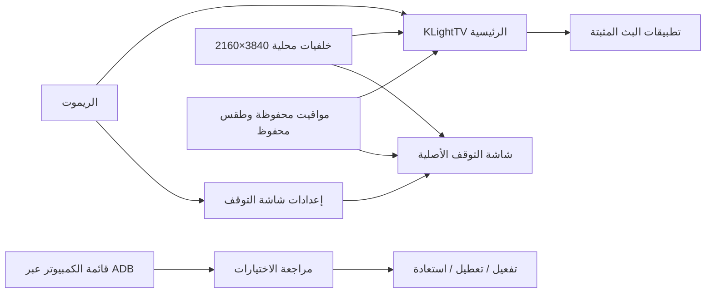
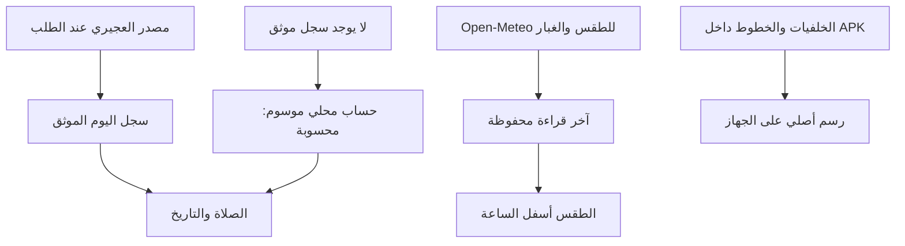

# كيف يعمل KLightTV

واجهتا Java أصليتان، مع خط محلي وصورة واحدة معروضة لكل واجهة. لا WebView في ملفات APK، ولا فيديو خلفية أو خدمة لتنزيل الصور. يُرسم النص بدقة الواجهة التي يتيحها Android على الجهاز، وتُحجّم الصور إلى مساحة العرض.

## البيانات والأداء

تُحدّث الساعة والعد التنازلي بالدقيقة، والطقس على فترات. تتوقف تحديثات الرئيسية عند الانتقال لتطبيق آخر. تتوقف مهام شاشة التوقف وتتحرر صورتها عند إغلاقها. تحسين صورة 4K حدث وقت إعداد الإصدار؛ لا يوجد نموذج ذكاء اصطناعي يعمل على التلفزيون.

بيانات الموقع التي يختارها المستخدم تُستخدم لطلبات الطقس؛ مواقيت مدينة الكويت تُطلب من المصدر الموثق عند توفره. المشروع لا يضيف خدمة تحليلات أو إعلانات. تعطيل حزم الشركة إجراء مستقل اختياري، ولا يثبت توقف جميع اتصالات النظام.

## المجلدات

| المسار | المحتوى |
|---|---|
| `android/launcher` | الرئيسية، المفضلة، بطاقات التطبيقات، التخصيص |
| `android/app` | شاشة التوقف ومعاينتها وإعداداتها |
| `android/shared` | عرض الصفحات وبيانات التقويم المشتركة |
| `assets/backgrounds` | خلفيات JPEG وبيانات المصدر والدقة |
| `assets/calendar` | بيانات التقويم المحفوظة |
| `tools/tv-manager` | قائمة التطبيقات المحلية على الكمبيوتر |
| `tools/render_brand.mjs` | مصدر رسومات لافتات KLightTV |
| `docs/images` | لقطات فعلية من المحاكي |
| `tests` | اختبارات الحساب والتقويم والإدارة ومعاينة المتصفح |
| `src` و`dist` | معاينة متصفح موروثة؛ ملف `urtv.html` محفوظ للتوافق، ولا يدخل APK |
| `optimize` | أدوات ADB موروثة؛ بعضها خاص بأجهزة معينة |

معرّفات `kw.urtv.*` وأسماء تفضيلاتها الداخلية باقية للتوافق مع التحديثات السابقة. الاسم الظاهر والمشروع والمثبتات **KLightTV**.
