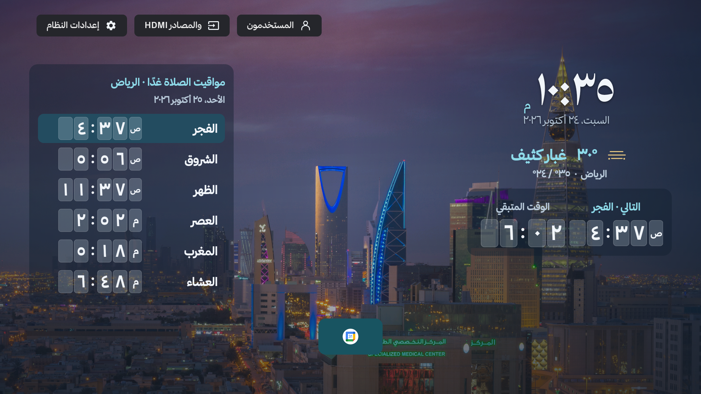
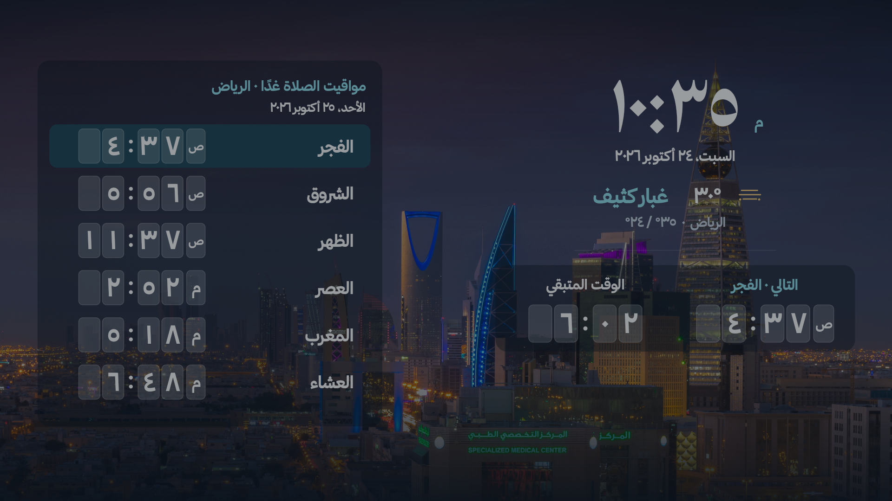
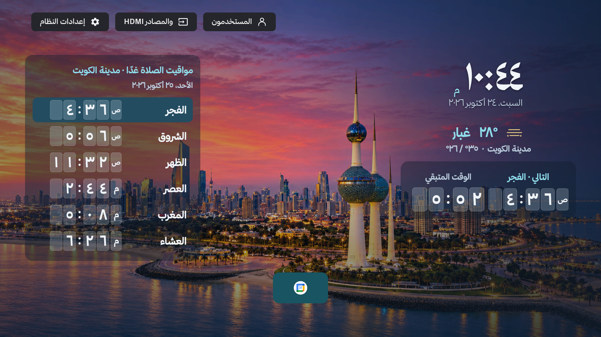
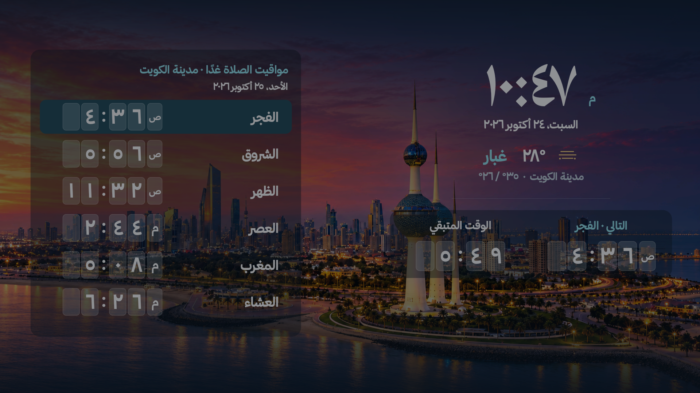

# خلفيات المدن — 2.0.1 / build 21

خلفية الرئيسية وشاشة التوقف مرتبطة **بمدينة الصلاة**، حتى عند تعيين مدينة طقس منفصلة من المتقدم. المطابقة تتطلب اسمًا معتمدًا للمدينة بالعربية أو الإنجليزية، والدولة والإحداثيات ضمن النطاق الحضري المدرج معًا؛ القرب وحده لا يسمح بإظهار دبي للشارقة أو الدوحة للوسيل. خارج النطاق، تُعرض خلفية هادئة. هذه مكتبة منتقاة لأربع مدن وليست تغطية لجميع مدن العالم.

## الصور ومصادرها

- **مدينة الكويت**: [KLightTV · user reference enhanced with AI](https://github.com/linkq8/KLightTV/blob/bd5c1e4/assets/backgrounds/backgrounds.json)، 3840 × 2160، User-provided composition; AI-enhanced and upscaled. صورة الكويت السابقة من مرجع المستخدم، محسّنة بالذكاء الاصطناعي ومكبّرة؛ ليست تصويرًا أصليًا بدقة 4K.
- **الرياض**: [B.alotaby](https://commons.wikimedia.org/wiki/File:Riyadh_Skyline.jpg)، 4109 × 2311، CC BY-SA 4.0. [الترخيص](https://creativecommons.org/licenses/by-sa/4.0).
- **دبي**: [Diego Delso](https://commons.wikimedia.org/wiki/File:Madinat_Jumeirah-Dubai3303.JPG)، 4167 × 2824، CC BY-SA 4.0. [الترخيص](https://creativecommons.org/licenses/by-sa/4.0).
- **الدوحة**: [P. Hughes](https://commons.wikimedia.org/wiki/File:Doha_-_West_Bay_Skyline_02.jpg)، 5188 × 3712، CC BY 4.0. [الترخيص](https://creativecommons.org/licenses/by/4.0).

الصور الأصلية لا تُعدّل؛ العرض يصغّرها وفق عتاد الجهاز ويقصها مركزيًا لتناسب الشاشة، مع طبقة تعتيم للقراءة. بيانات النسب والترخيص متاحة أيضًا من إعدادات KLightTV ← المظهر والقراءة ← صورة المدينة ومصدرها. المصوّر لا يؤيد التطبيق بالضرورة.

## الخفة وحالات التعذر

- لا تُضمّن صور المدن الكاملة في أي من APKs، ولا تُحمّل مكتبة الدول عند الإعداد.
- ملف واحد مشترك داخل ذاكرة التخزين المؤقت للرئيسية؛ شاشة التوقف تقرؤه عبر مزوّد محتوى محمي بتوقيع التطبيق. يلزم تثبيت التطبيقين بالتوقيع نفسه.
- عند طلب مدينة جديدة تُحذف صورة المدينة السابقة. حد الملف 20 MiB، وتحميل مؤقت واحد فقط؛ تُرفض الملفات الأكبر والصور بأبعاد غير معقولة.
- التحميل وفك الصورة خارج خيط الواجهة. دقة فك الصورة حسب سياسة عتاد الجهاز، بصيغة RGB565. لا خدمة تنزيل دائمة ولا مهام خلفية خارج العرض.
- تعود صورة المدينة المحفوظة دون إنترنت. عند أول استخدام دون إنترنت أو تعذر المصدر تظهر الخلفية الهادئة، مع إعادة محاولة محدودة أثناء العرض فقط؛ الوضع البسيط لا يطلب صورًا.
- تغيير المدينة يلغي عرض النتائج القديمة، حتى لو انتهى تنزيلها متأخرًا. لا رجوع لصورة الكويت عند الخطأ.
- كل مدينة لها صورة منتقاة واحدة حاليًا؛ لا يوجد تدوير عدة صور أو اختيار مصوّر عشوائي. إعداد التثبيت القديم يبقى محفوظًا ولا يختار صورة مدينة أخرى.

## التحقق

`tests/city_wallpaper_test.py` يختبر المطابقة الفعلية ورفض الدول/المدن المجاورة والقيم غير الصالحة، ويتحقق من بيانات المصدر ومن عدم تضمين حزم الصور. لقطات المحاكي وسجل الاختبارات في `images/city-wallpapers-v21/`. لم يُثبّت هذا التحديث على تلفزيون فعلي.

## لقطات فعلية من المحاكي

الرياض — الرئيسية وشاشة التوقف:

الكويت — الرئيسية وشاشة التوقف:

