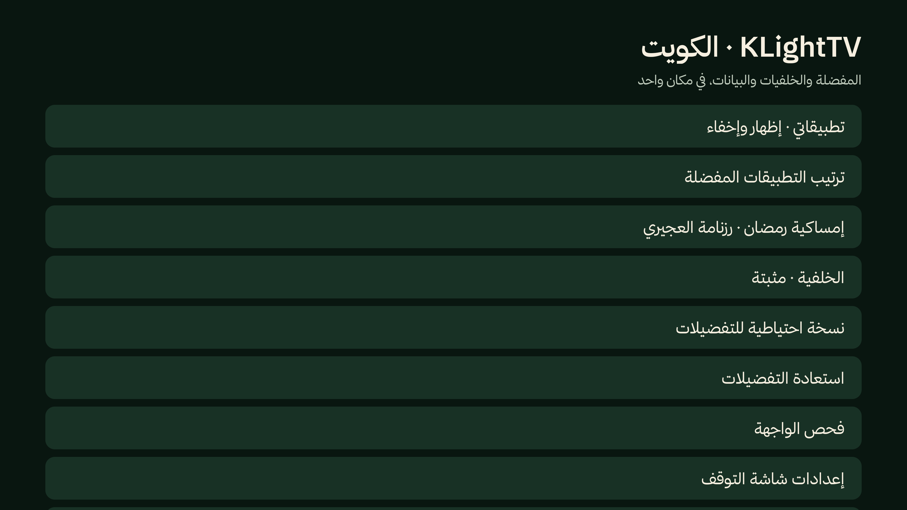

# تثبيت KLightTV

التطبيقان مستقلان: يمكنك استخدام شاشة التوقف وحدها، أو تثبيت الاثنين. يتطلب كلاهما Android 8.0 أو أحدث. ملفات الإصدار الموقعة في [GitHub Releases](https://github.com/linkq8/KLightTV/releases).

## التثبيت من التلفزيون

1. نزّل `KLightTV-screensaver-android-tv.apk` و`KLightTV-home-android-tv.apk` من الإصدار نفسه، وانقلهما إلى التلفزيون بواسطة USB أو مدير ملفات موثوق.
2. اسمح لمدير الملفات بتثبيت التطبيقات من مصادر أخرى عند طلب Android، ثم افتح ملفّي APK لتثبيتهما.
3. افتح **KLightTV · شاشة التوقف** من قائمة التطبيقات. استخدم المعاينة لضبط مدينة الكويت والصلاة والطقس.
4. افتح إعدادات التلفزيون ← تفضيلات الجهاز/النظام ← شاشة التوقف/الوضع المحيط، واختر **KLightTV · شاشة التوقف**. المسار يختلف حسب الشركة؛ بعض الأجهزة تمنع شاشة توقف خارجية.
5. للرئيسية، اضغط Home واختر **KLightTV** إن ظهر منتقي الواجهات، أو افتح إعدادات التطبيقات الافتراضية. لا تعطل Home الأصلي لتجربة الواجهة.


## التثبيت باستخدام ADB

ثبّت [Android SDK Platform-Tools](https://developer.android.com/tools/releases/platform-tools)، وفعّل خيارات المطور والتصحيح من إعدادات التلفزيون. `TV_IP:PORT` رمز استبدله بعنوان الجهاز والمنفذ الفعليين، وليس عنوانًا جاهزًا للنسخ.

في الأجهزة الأقدم التي تعرض ADB عبر الشبكة:

```sh
adb connect TV_IP:PORT
adb devices -l
```

في الأجهزة التي تعرض **Wireless debugging / Pair device with pairing code**، استخدم منفذي الاقتران والاتصال الظاهرين على الجهاز؛ قد يختلفان:

```sh
adb pair TV_IP:PAIRING_PORT
adb connect TV_IP:DEBUG_PORT
adb devices -l
```

وافق على رسالة التصحيح في التلفزيون. إذا ظهر `unauthorized`، انتظر الموافقة ثم أعد `adb devices -l`. اختر جهازًا واحدًا صراحةً في كل أمر:

```sh
adb -s TV_IP:PORT install -r KLightTV-screensaver-android-tv.apk
adb -s TV_IP:PORT install -r KLightTV-home-android-tv.apk
adb -s TV_IP:PORT shell am start -n kw.urtv.screensaver/.SettingsActivity
adb -s TV_IP:PORT shell am start -n kw.urtv.home/.MainActivity
```

على المحاكي، استخدم `emulator-5554` بدل `TV_IP:PORT`. الخيار `-r` يحدّث النسخة الموقعة بالمفتاح نفسه ويحفظ البيانات. عند `INSTALL_FAILED_UPDATE_INCOMPATIBLE` توقّف واستخدم الإصدار الصحيح؛ الإزالة تمسح التفضيلات.

يمكن اختيار Home عبر ADB على البرامج الثابتة التي تسمح بذلك، بعد التأكد من أن المعاينة تعمل:

```sh
adb -s TV_IP:PORT shell cmd package set-home-activity --user 0 kw.urtv.home/.MainActivity
adb -s TV_IP:PORT shell input keyevent KEYCODE_HOME
```

إذا رفض النظام الأمر، استخدم منتقي Home أو أبقِ واجهة المصنع. أدوات `optimize/` موروثة وبعضها يغيّر حزم الشركة؛ لا تشغّل `run.sh` أو `install.sh` على جهاز مجهول لمجرد المعاينة. التثبيت اليدوي أعلاه لا يعطل تطبيقات الشركة.

## ضبط الواجهة

- من إعدادات الرئيسية افتح **KLightTV · الكويت** ثم «الخلفية»، واختر «الكويت عند الغروب · 4K محسّنة» لتثبيت الصورة المشتركة مع شاشة التوقف.
- «تطبيقاتي» للإظهار والإخفاء. الضغط المطوّل على تطبيق يفتح خياراته، ومنها إلغاء التثبيت عبر نافذة Android. بعض تطبيقات النظام لا تسمح الشركة بإزالتها.
- «ترتيب التطبيقات المفضلة» لتغيير ترتيب الصف. تظهر الخدمات المثبتة فقط؛ لا تُثبّت معها تطبيقات TOD أو Prime أو شاشا أو Stremio أو YouTube تلقائيًا.
- من شاشة التوقف اختر بطاقة مواقيت الصلاة؛ يبقى الطقس أسفل الساعة. البيانات المحسوبة تحمل وسمها عندما لا يتوفر سجل رسمي.
- لإدارة الخدمات الخلفية استخدم [قائمة الكمبيوتر](../tools/tv-manager/README.md)، وراجع كل عملية قبل تطبيقها.




## الاستعادة والإزالة

اختر واجهة الشركة من إعدادات التطبيقات الافتراضية/تطبيق Home قبل إزالة KLightTV. إذا كنت استخدمت أداة الكمبيوتر، استعد تغييراتها من «استعادة آخر عملية» على الجهاز نفسه. لا تحذف بيانات أداة الكمبيوتر قبل الاستعادة.

لإزالة التطبيقين بعد استعادة Home الأصلي، استخدم إعدادات تطبيقات Android أو:

```sh
adb -s TV_IP:PORT uninstall kw.urtv.home
adb -s TV_IP:PORT uninstall kw.urtv.screensaver
```

هذه الإزالة تمسح تفضيلات التطبيقين. لا تتطلب التجربة أو التثبيت إعادة ضبط المصنع أو root.
