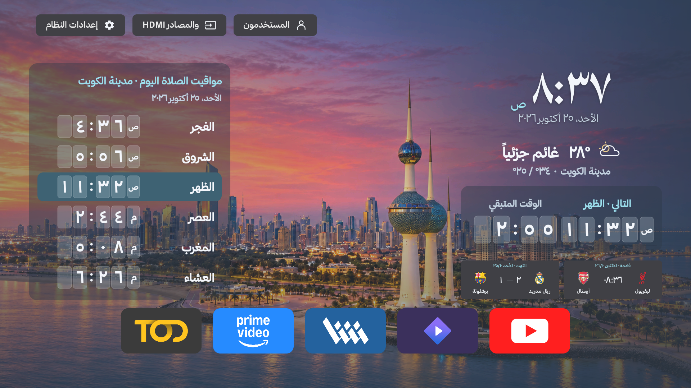
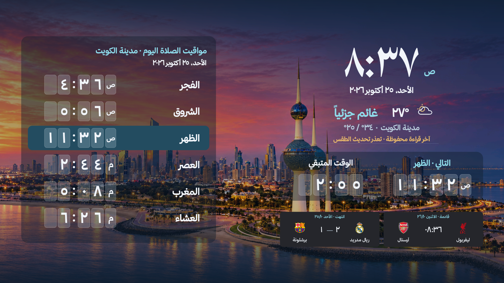
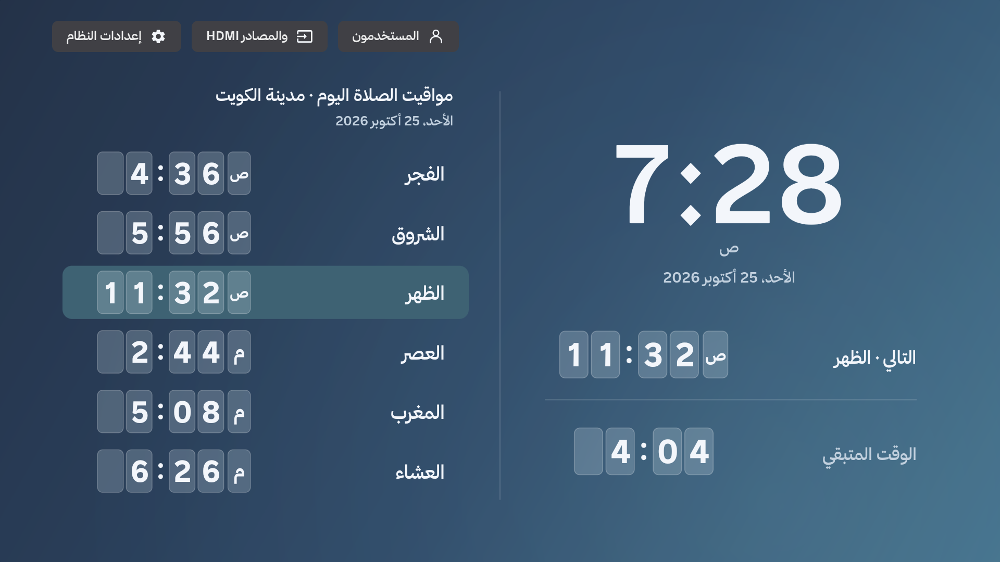
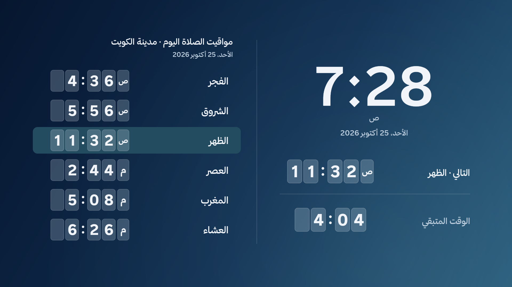
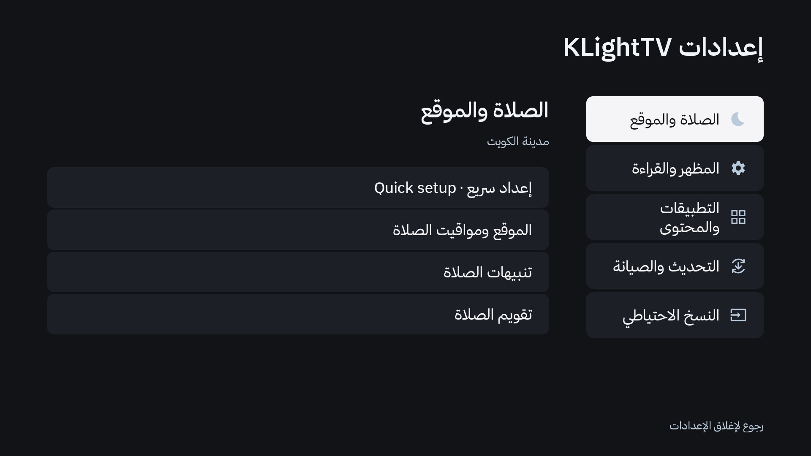
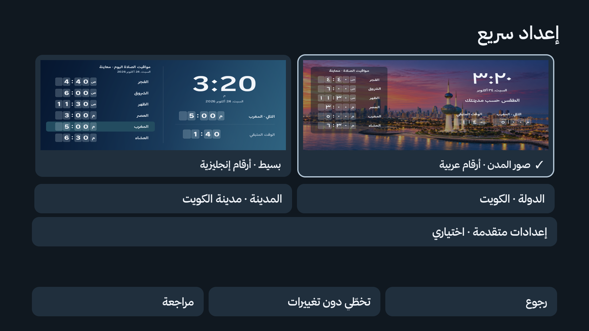
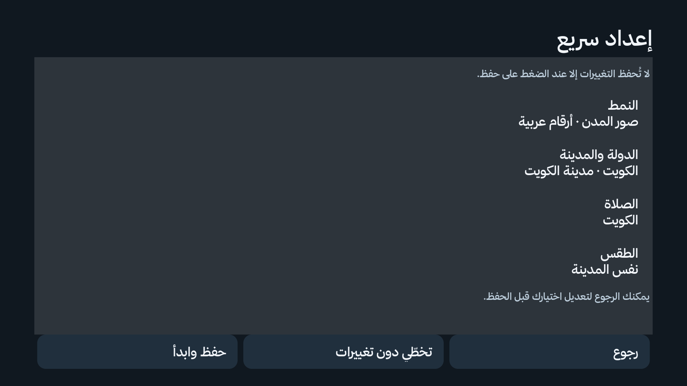

# آخر معاينة للواجهة

لقطات فعلية من محاكي Android API34، بدقة 1920×1080، بتاريخ 25 أكتوبر 2026. بيانات المباريات تجريبية وليست نتائج أو مواعيد حقيقية. أول أربعة تطبيقات في الصف حزم معاينة تعرض الشعارات؛ YouTube تطبيق مثبت على المحاكي. لا تتضمن نسخة التطبيق هذه الحزم أو بيانات المباريات التجريبية.

أحدث تعديل يكبّر بطاقات التطبيقات والشعارات والأسماء، ويوحّد المسافات دون تغيير خط الساعة أو جدول الصلاة. الاختبارات الوظيفية نجحت؛ لم يتم تثبيت التعديل على تلفاز أو نشر إصدار تنزيل جديد.

## الرئيسية — نمط المدينة

## شاشة التوقف — نمط المدينة

## الرئيسية — النمط البسيط

## شاشة التوقف — النمط البسيط

## إعدادات KLightTV

## الإعداد السريع — النمط والدولة والمدينة

## الإعداد السريع — المراجعة قبل الحفظ

شاشة التوقف في لقطة المدينة تعرض تنبيه الطقس المحفوظ عند تعذّر التحديث. [تقرير الاختبار وحدوده](testing/modes-2026-10-25.md).
