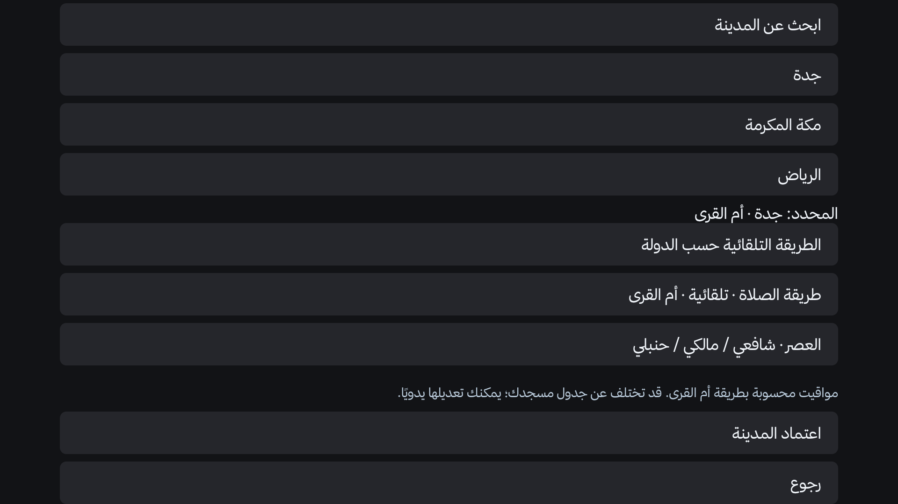
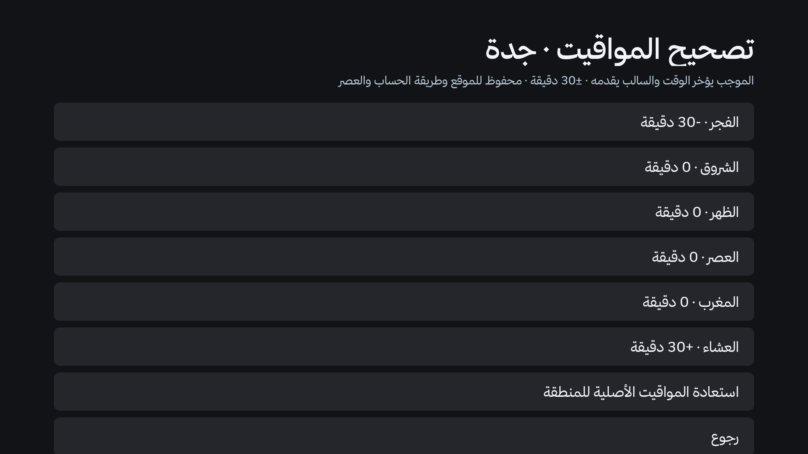

# إصلاح الموقع القديم وتصحيح المواقيت — 2.0.0، معاينة التطوير

## الاستخدام

افتح تطبيق **KLightTV ← الصلاة والموقع ← الموقع ومواقيت الصلاة ← الدولة والمدينة**. اختر الدولة ثم المدينة واضغط «اعتماد المدينة». للسعودية تُختار **أم القرى تلقائيًا**؛ جدة ومكة والرياض تستخدم كل منها إحداثياتها، وليس توقيت مكة المنسوخ إلى بقية المدن. «الطريقة التلقائية حسب الدولة» تعيد اقتراح الدولة؛ اختيار «طريقة الصلاة» يدويًا يُحفظ حتى تغيّره. اختيار العصر مستقل.

من «تصحيح مواقيت الصلاة» اختر من **−30 إلى +30 دقيقة** لكل وقت. الموجب يؤخر والسالب يقدم. التصحيح محفوظ مع الدولة والإحداثيات والمنطقة الزمنية والطريقة والعصر؛ عند الانتقال لسياق آخر تبدأ تصحيحاته بصفر، وعند العودة للسياق السابق تعود تصحيحاته الخاصة.

النسخ الاحتياطي داخل التطبيق يشمل الموقع وطريقته وتصحيحات السياق الحالي، بالإضافة إلى تفضيلات العرض. ملفات النسخ القديمة دون موقع تبقى مقبولة دون تغيير الموقع الحالي. تُرفض التصحيحات خارج النطاق أو غير المكوّنة من ست قيم.

## ترقية الإعداد القديم

- الإعداد القديم الذي يحفظ اسم المدينة وإحداثياتها دون دولة كان يفرض الكويت. تُرحّل نقاط جدة ومكة والرياض المعروفة إلى السعودية/Asia-Riyadh/أم القرى، ونقاط مناطق الكويت المعروفة إلى الكويت. الاستدلال محدود بمحيط صغير من نقاط معروفة؛ لا تستخدم خريطة مستطيلة أو الاسم وحده لتخمين دولة كل مكان.
- إذا تعذّر تحديد الدولة، تُحفظ الإحداثيات القديمة ويُطلب إعادة اعتماد الدولة والمدينة. تتوقف المواقيت والتنبيهات غير الموثوقة حتى الاعتماد، بدل الرجوع الصامت إلى الكويت.
- بيانات `place` القديمة التي تحمل الكويت وطريقة الكويت مع إحداثيات سعودية معروفة تُصحَّح أيضًا. الاختيار اليدوي الصريح الذي يحمل `manualMethod=true` يُحترم. بيانات JSON القديمة لا تحمل أصل الاختيار؛ باقي الطرق القديمة تعامل كاختيار يدوي للمحافظة عليها.
- تعويضات الإصدارات القديمة المحفوظة بالإحداثيات فقط **لا تُطبّق تلقائيًا** على السياق الجديد؛ تبقى مفاتيحها القديمة محفوظة محليًا، لكن يلزم إدخال التصحيح المطلوب مجددًا. يمنع ذلك تراكم تعويض العشاء القديم فوق أم القرى.

## الحساب والمراجع

المحرك المشترك `WorldPrayers` ومكتبة Adhan Java 1.2.1 مستخدمان في الرئيسية وشاشة التوقف والتقويم والتنبيهات. أم القرى: الفجر **18.5°**، والعشاء **90 دقيقة** بعد المغرب، أو **120 دقيقة** خلال الشهر التاسع بحسب `HijrahDate` (تقويم Umm al-Qura المدمج في Java). القرار يخص التاريخ المدني المحلي للجدول؛ لا توجد تغذية لإعلانات رؤية الهلال ولا تبديل للشهر بمجرد غروب الشمس. قد تختلف بداية الشهر المعلنة محليًا؛ لم نضف تخمينًا أو استثناءً ثابتًا لسنة معينة. للتواريخ خارج نطاق `HijrahDate` لا نخمن رمضان.

- [دليل معاملات Adhan](https://github.com/batoulapps/adhan-js/blob/develop/METHODS.md): مرجع المعاملات؛ ليس جدول مسجد رسميًا.
- [واس — استعدادات الشؤون الإسلامية بمكة](https://www.spa.gov.sa/w1872554) و[واس — الالتزام بمدة الانتظار](https://www.spa.gov.sa/w1541831): مراجع تنظيمية، وليست جداول يومية لكل مدينة. تعذّر استخراج النص الكامل آليًا من الصفحتين، لذلك لم نستخدمهما كقيم اختبار رقمية.
- [توثيق AlAdhan](https://aladhan.com/prayer-times-api): مقارنة مستقلة بطريقة 4، محفوظة في `tests/fixtures/saudi-method4.json`: تسع حالات لثلاث مدن في أكتوبر وديسمبر وفبراير، بأقصى فرق دقيقتين. **هذه مقارنة حسابية وليست شهادة اعتماد رسمي**.
- [اختبارات Adhan Java الأصلية](https://github.com/batoulapps/adhan-java/blob/master/adhan/src/test/java/com/batoulapps/adhan/PrayerTimesTest.java): أُعيد التحقق من حالة Raleigh المنشورة.
- جدول [البلاغ #1](https://github.com/linkq8/KLightTV/issues/1) وصف للمشكلة، ولم نعتمده جدولًا رسميًا أو هدفًا لإجبار النتائج على مطابقته.

## التحقق وحدوده

`python3 tests/prayer_regression_test.py` يشغّل كود Place وPrefs وWorldPrayers الفعلي مع تخزين Android بديل في الذاكرة: الترحيل، إعادة القراءة، الاختيار اليدوي، فصل ملفات التصحيح، حدود ±30 واستيرادها، 20 حالة مدينة/فصل، حدود رمضان 1447 و1448، التنبيه 0/5/10 دقائق، وعدم نسخ وقت مكة إلى جدة. تحتاج مكتبة Adhan في Gradle cache وorg.json في `JSON_JAR` (الافتراضي `/tmp/klight-test-json.jar`). CI يجلب الاعتماديات ويشغّل الاختبار بعد بناء Android.

الجداول الكويتية الموثقة وسياسة الخيران كما كانت؛ الحساب السعودي لا يحمل وصف «جدول رسمي». لا تشمل هذه المهمة استكمال صور الرياض أو تبسيط الإعدادات المقترح سابقًا.

لم يُثبّت هذا التعديل على تلفاز المستخدم، ولم يُختبر على عتاد Xiaomi أو Skyworth في هذه المهمة. الاختبار الحسابي واللقطات لا يثبتان مطابقة جدول مسجد بعينه أو إطلاق تنبيه فوق كل تطبيق بث على كل تلفاز.

## لقطات فعلية من المحاكي

محاكي Android API34 ARM64 بوضع أفقي 1920×1080، وليس عتاد Xiaomi أو صورة نظام تلفاز شركة. استُخدم نمط التركيز حتى لا توحي صور الكويت بأن صور المدن العالمية اكتملت. هذه صور تشغيل للتطبيق؛ لم تُولّد رسومات بديلة للواجهة. تطبيقات البث ليست مثبتة على المحاكي الجديد. قد يختلف الطقس بين لقطتين بسبب توقيت تحديث المصدر.

| المدينة | الرئيسية | شاشة التوقف |
|---|---|---|
| جدة — بعد ترحيل إعداد قديم بلا دولة | [الصورة](images/prayer-location-fix/jeddah-home.png) | [الصورة](images/prayer-location-fix/jeddah-saver.png) |
| مكة المكرمة | [الصورة](images/prayer-location-fix/makkah-home.png) | [الصورة](images/prayer-location-fix/makkah-saver.png) |
| الرياض | [الصورة](images/prayer-location-fix/riyadh-home.png) | [الصورة](images/prayer-location-fix/riyadh-saver.png) |
| مدينة الكويت | [الصورة](images/prayer-location-fix/kuwait-home.png) | [الصورة](images/prayer-location-fix/kuwait-saver.png) |

قورنت الأشجار النصية الفعلية للشاشتين: الأوقات الستة متطابقة في المدن الأربع (24 مقارنة)، وموجودة في [ملخص التحقق](images/prayer-location-fix/verified-schedules.json). حفظ الموقع والتصحيح والتبديل بين التطبيقات فُحص على المحاكي، إضافة إلى اختبارات التخزين البديل.

فُحصت جدولة AlarmManager الفعلية لتذكير المغرب في جدة قبل عشر دقائق: 17:42 لموعد 17:52، بساعة اختبار مضبوطة على المحاكي؛ أُعيد ضبط الساعة بعد الاختبار. سُجل إنشاء نافذة التنبيه في WindowManager، لكن التقاط التنبيه المرئي القصير لم ينجح بثبات بسبب تأخر الرسم وإشعارات النظام في المحاكي؛ لا تُنشر صورة لا يظهر فيها التنبيه ولا ندّعي اختبار وصوله فوق تطبيق بث تجاري في هذه المهمة. اختبارات الخطة تغطي 0/5/10 دقائق واستثناء الشروق وتطابق جدول الحساب المشترك.
