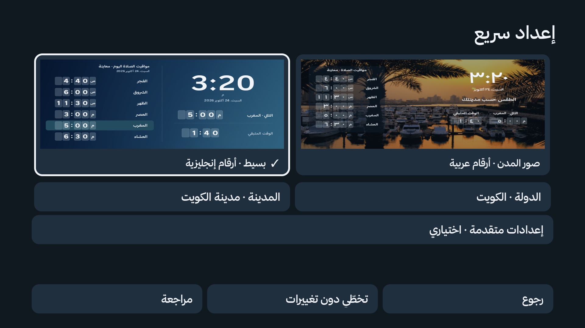
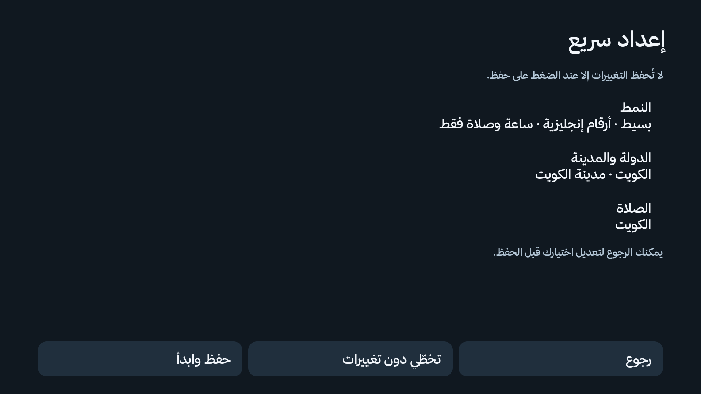

# الإعداد السريع

**2.0.1، البناء 21 للتطوير.** معاينتان قابلتان للاختيار بالريموت، ثم الدولة والمدينة ومراجعة قبل الحفظ. يعمل المعالج عند الطلب فقط، دون خدمة خلفية أو مكتبة مدن محمّلة على التلفاز.

1. اختر **صور المدن وأرقامًا عربية** أو **بسيط وأرقامًا إنجليزية**.
2. اختر الدولة، ثم **المدينة أو المنطقة — مطلوبة قبل الحفظ**. تُستخدم المدينة نفسها للصلاة والطقس؛ لا يُطلب اختيارها مرتين.
3. راجع الاختيارات واضغط **حفظ وابدأ**. الرجوع أو التخطي لا يحفظ تغييرات المحتوى.

اختيار الدولة وحده لا يغيّر مدينة محفوظة ولا طريقة صلاة يدوية. يجب أن تكون المدينة المختارة ضمن الدولة قبل إتمام المعالج. في التثبيت الجديد تكون الصلاة والطقس غير مفعّلين إلى أن يراجع المستخدم الإعداد ويحفظه؛ يمكن إيقاف الصلاة من الخيارات المتقدمة.

## النمطان

| النمط | الأرقام | المحتوى |
|---|---|---|
| صور المدن | عربية | الصلاة والساعة والطقس، ومباريات المفضلة وفق إعداداتها |
| بسيط | إنجليزية | الساعة ومواقيت الصلاة والتالي والمتبقي؛ دون طقس أو نتائج مباريات في الرئيسية وشاشة التوقف |

يحجب الوضع البسيط تحديث الطقس وقراءة بطاقات المباريات أيضًا. يحتفظ بتفضيلات النمط المصوّر لاستعادتها عند العودة إليه. الوضع البسيط يوزع الساعة والصلاة على مساحة الشاشة، وتظهر التطبيقات عند التنقل إلى الأسفل. إعدادات Android والمصادر والمستخدمون متاحة في الأعلى.

**خلفيات المدينة (2.0.1):** تُنزّل صورة المدينة المختارة فقط، وتُستخدم النسخة نفسها في الرئيسية وشاشة التوقف. تتوفر صور منتقاة لمدينة الكويت والرياض ودبي والدوحة؛ المدن الأخرى تستخدم خلفية هادئة، ولا تستعير صورة الكويت. لا توجد حزمة صور كاملة داخل التطبيق. [المصادر وحدود التغطية](CITY-WALLPAPERS.md).

## الإعدادات المتقدمة

لغة المعالج العربية/الإنجليزية، المظهر الفاتح/الداكن، لون خلفية الوضع البسيط، إيقاف الصلاة، طريقة الحساب والعصر، الإحداثيات والمنطقة الزمنية. عند الحاجة فقط يمكن فصل مدينة الطقس عن المدينة الرئيسية. تعريب بقية شاشات التطبيق لم يتحول إلى ترجمة إنجليزية شاملة.

طرق الحساب القائمة ومحرك Adhan وتعديلات الدقائق المستقلة بحسب الموقع والطريقة باقية. اختيار الدولة ليس تحديدًا لمعتقد المستخدم؛ الصلاة قابلة للإيقاف. لا يفعّل المعالج تنبيهات جديدة أو خدمة تغيير أزرار الريموت، ولا يعطّل تطبيقات أو وظائف تلفاز.

## العودة إلى المعالج

افتح تطبيق **KLightTV ← الصلاة والموقع ← إعداد سريع**. يظهر مرة واحدة تلقائيًا في التثبيت الجديد. لا يُفرض بعد ترقية تثبيت قديم، ولا يعود تلقائيًا بعد التخطي. اختيار المدينة يتم بالبحث عند الطلب عبر GeoNames/Open-Meteo، مع اختيارات سريعة للكويت وبعض المدن؛ الإحداثيات المتقدمة تستخدم التحقق نفسه للموقع وطريقة الحساب.

البحث عن مدينة جديدة يحتاج اتصالًا بالإنترنت؛ لا تُحمّل قاعدة مدن عالمية. بعد حفظ الموقع تُحسب المواقيت محليًا، ويحتاج تحديث الطقس إلى الشبكة.

يحتفظ المعالج بمسودة غير محفوظة أثناء المراجعة والتنقّل إلى منتقي المدينة. تُحفظ المدينة وتفضيلات العرض في عملية تخزين واحدة بعد التأكيد. لا يحذف ملفات التصحيح السابقة، ولا يبدّل إعدادات الأزرار والتطبيقات.

## اللقطات والتحقق

الصور أدناه لقطات تشغيل فعلية من محاكي Android API34 ARM64 أفقي 1920×1080، وليست تصورات مولّدة. المحاكي ليس صورة نظام Xiaomi أو Skyworth، ولا يحتوي تطبيقات البث المعتادة على التلفاز.

| النمط | الرئيسية | شاشة التوقف |
|---|---|---|
| البسيط | [لقطة](images/quick-setup-v20/simple-home-final.png) | [لقطة](images/quick-setup-v20/simple-saver.png) |
| صور الكويت | [لقطة](images/quick-setup-v20/photo-home.png) | [لقطة](images/quick-setup-v20/photo-saver.png) |

المصغّرات داخل صفحة الاختيار معاينات توضيحية؛ الصور أعلاه لقطات فعلية للواجهة. [سجل اختبار المحاكي](images/quick-setup-v20/verification.json).

## مستخدمو Google TV

زر **المستخدمون** في الرئيسية يتيح فتح مُبدّل الملفات الأصلي إذا كان متاحًا ومسموحًا لتطبيق خارجي، أو فتح واجهة Google TV الأصلية لاختيار صورة المستخدم. يوجد بديل لإعدادات الحسابات؛ **إدارة الحسابات لا تعني تبديل الملف النشط**.

لا يعطل هذا الخيار واجهة Google الأصلية، ولا يغير التطبيق الافتراضي أو أزرار الريموت، ولا يقرأ الحسابات أو بيانات الدخول. إعدادات KLightTV مشتركة حاليًا وليست ملفات مستقلة لكل حساب Google TV.

[تعليمات Google الرسمية للملفات](https://support.google.com/googletv/answer/10050564?hl=en). وجهة ProfileChooserActivity غير مضمونة في كل إصدار، لذلك تُفحص صلاحية فتحها على الجهاز وتتوفر واجهة Google الأصلية كبديل.

**حد التحقق:** المحاكي لا يحتوي واجهة Google TV أو ملفاتها. اختُبرت حالة الغياب والوصول إلى إعدادات الحسابات، ولم يُثبت نجاح التبديل الفعلي على TCL. إن كانت واجهة Google TV معطّلة سابقًا، تحتاج استعادة آمنة بعد فحص الجهاز.

التحديث للمراجعة في مسودة GitHub؛ لا يتضمن تثبيتًا على تلفاز فعلي أو إصدار Release. اختبارات المواقيت ومراجعها وحدود مطابقتها للجداول الرسمية موثقة في [إصلاح الموقع](PRAYER-LOCATION-FIX.md).
