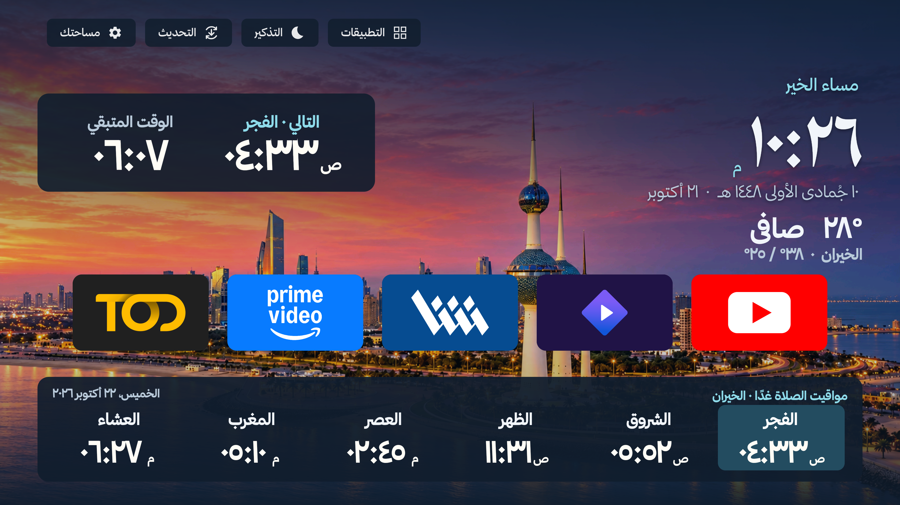
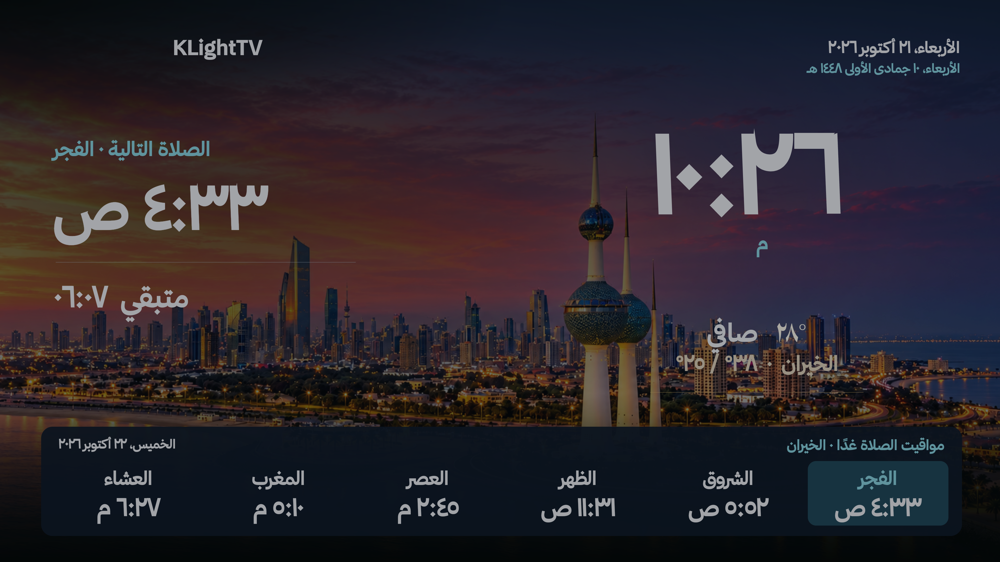
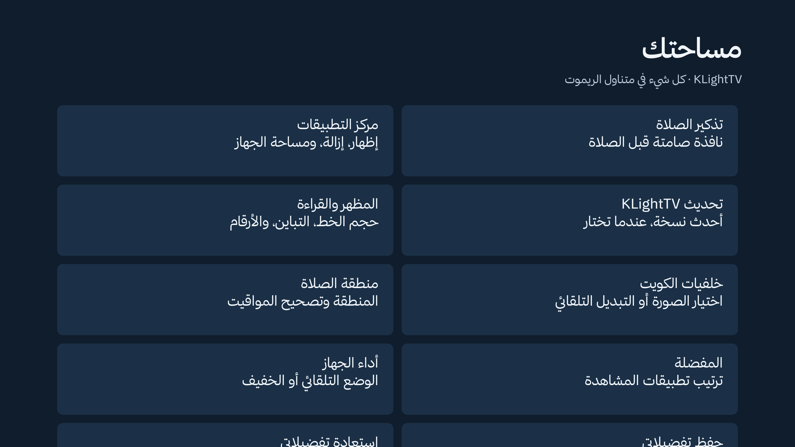
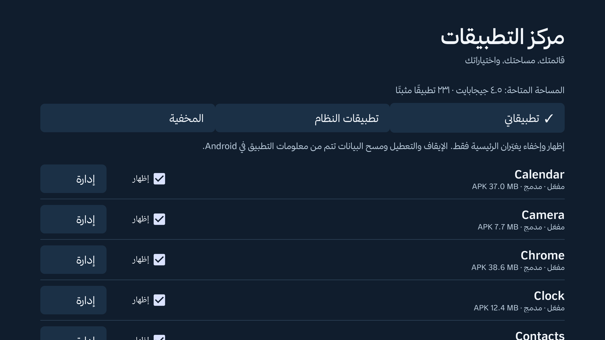
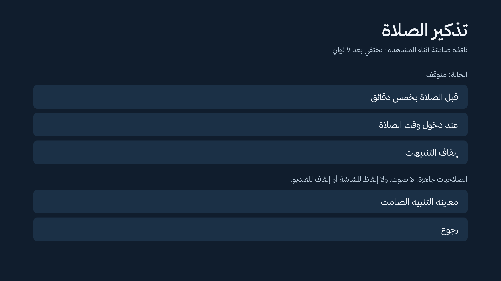
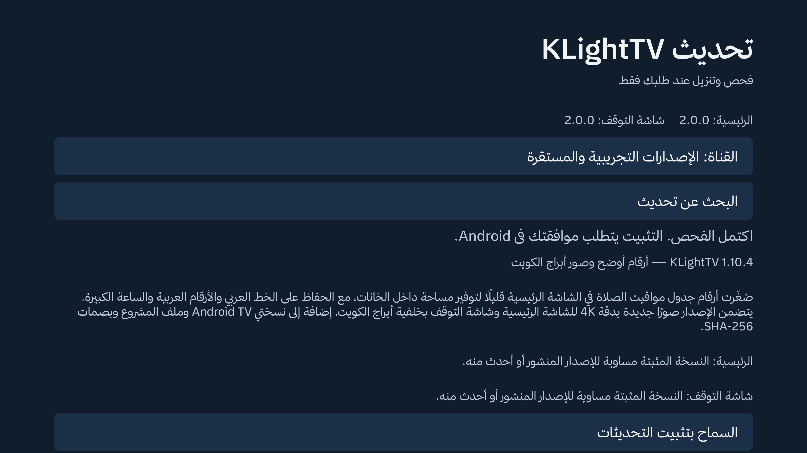
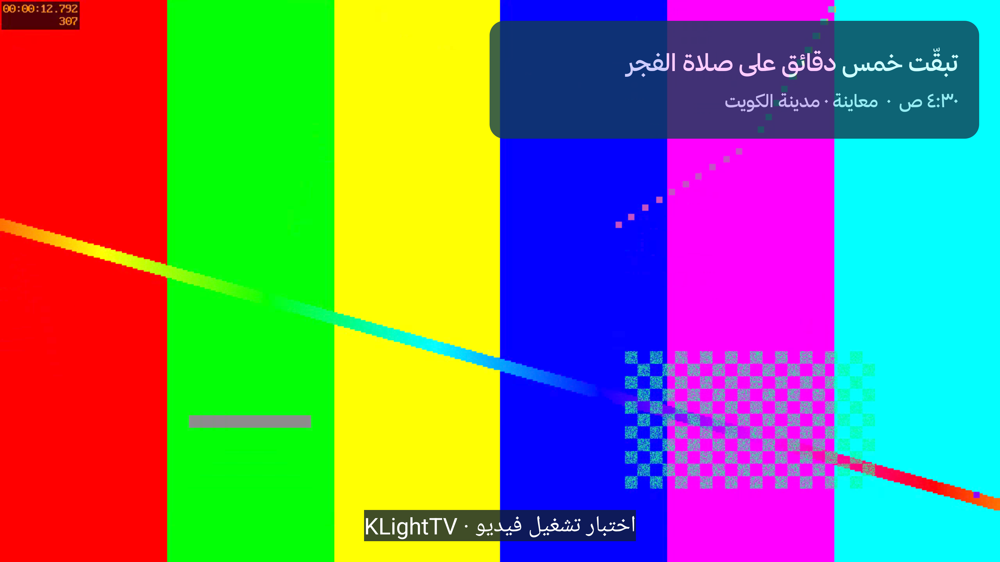

# KLightTV 2.0.0 — معاينة محلية

أعيد تصميم الرئيسية وشاشة التوقف ومساحة الإعدادات بهوية كحلية وزرقاء فاتحة، وجدول صلاة أفقي، مع إبقاء المناطق وتصحيح المواقيت والطقس وخلفيات الكويت وخيارات القراءة والأداء.

- تذكير مرئي صامت قبل الصلاة بخمس دقائق أو عند دخول الوقت. يختفي بعد سبع ثوانٍ؛ يمكن إيقافه. يستخدم المنطقة والتصحيحات نفسها، ويستثني الشروق.
- تحديث يدوي من GitHub. يتحقق من SHA-256 والحجم والحزمة والتوقيع ورقم الإصدار قبل طلب التثبيت من Android. لا يوجد فحص دوري أو تنزيل تلقائي؛ مغادرة الصفحة تلغي التنزيل.
- مركز التطبيقات: إظهار وإخفاء مع تراجع، التطبيقات المدمجة، المساحة المتاحة، صفحات من عشرين عنصرًا، ومعلومات التطبيق وإلغاء التثبيت بموافقة Android.

## التفعيل

من الرئيسية افتح **التذكير**، واسمح بالظهور فوق التطبيقات والمنبهات الدقيقة إن طلب Android ذلك، ثم اختر **قبل الصلاة بخمس دقائق**. يمكنك تجربة زر المعاينة. الإعداد الافتراضي متوقف حتى تختاره.

من **التحديث** اختر البحث عن تحديث. تظهر أزرار التنزيل للإصدار الأحدث فقط؛ يتطلب تثبيته السماح بالتثبيت من هذا التطبيق ثم تأكيد Android.

## الاختبارات — 21 أكتوبر 2026

- بناء APK موقّع للوحدتين ونجاح Gradle lintVital.
- `python3 tests/prayer_alerts_test.py`: مهلة التنبيه، استثناء الشروق، تخطي التنبيه المنقضي، فجر الغد وانتقال السنة والتصحيحات.
- `python3 tests/prayer_table_day_test.py`: عشاء +30 دقيقة ومنتصف الليل وحدود التاريخ ومطابقة الفجر التالي.
- `python3 tests/regions_test.py`: 13 منطقة، المراجع الموسمية للخيران وسياسة العتاد.
- محاكي Android 14 ARM بدقة 3840×2160: وصول تنبيه AlarmManager حقيقي فوق تطبيق اختبار يشغّل فيديو محليًا، استمرار تقدم الفيديو، إزالة النافذة، جدولة الموعد التالي وإلغاء الموعد عند التعطيل. أزيل تطبيقا الاختبار بعد التحقق.
- فحص GitHub حقيقي: اكتشاف المنشور1.10.4، وعرض أن المثبت2.0.0 أحدث دون عرض تنزيله. لم تُختبر ترقية منشورة أحدث من2.0.0 بعد.
- حفظ إظهار/إخفاء تطبيق بعد إعادة فتح المركز، إعادة اختياره الأصلي، فتح معلومات Android والعودة وإعادة قراءة القائمة.
- مراجعة الصور النهائية: فصل التاريخ والطقس، وضوح رمز التحديث، ترتيب العربية في ملخص المساحة، الجدول الأفقي وخيارات التحكم.

## الأداء وحدود التوافق

لا تضيف المميزات خدمة دائمة: منبه واحد فقط، نافذة قصيرة، فحص التحديثات عند الطلب، وجرد التطبيقات عند فتح المركز. بقي تحرير صور الخلفية عند مغادرة الرئيسية والوضع الخفيف.

لقطة قياس لمحاكي4K بعد فتح الرئيسية: PSS نحو140 MiB؛ بعد الانتقال إلى مشغّل الفيديو نحو74 MiB. كان عدد WebView صفرًا، ولم يعرض dumpsys أي خدمة نشطة للحزمتين في وقت الاختبار. هذه قياسات ذاكرة منفردة وليست مقارنة سرعة أو ضمانًا لأداء كل تلفاز؛ لم تُجرَ تجربة على تلفاز فعلي في هذه الجولة.

بعض التطبيقات المحمية تمنع النوافذ العائمة؛ إعدادات Android نفسها أخفتها أثناء الاختبار، بينما ظهرت فوق مشغّل الفيديو. قد تختلف الصلاحيات حسب الشركة. التنبيه لا يوقظ شاشة مطفأة ولا يطلب تركيز الصوت.

التعطيل ومسح البيانات وإيقاف تطبيقات النظام يخضع لصلاحيات Android والشركة؛ الإخفاء من الرئيسية لا يوقف التطبيق بالخلفية. لا يجري حذف أو تعطيل تلقائي لأي تطبيق.

## الصور

